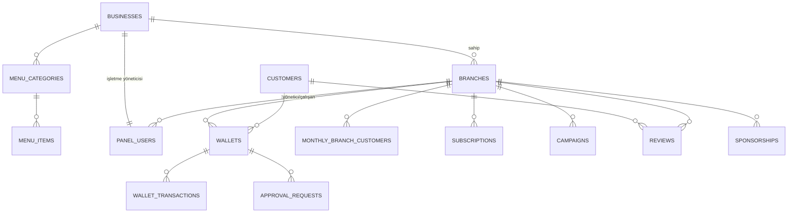

# Kumbare – Teknik Tasarım: Veritabanı

> Kaynak: `iş planı.txt`. Diğer parçalar: `teknik-tasarim-api.md` (backend ve API), `teknik-tasarim-web.md` (web sitesi ve paneller), `teknik-tasarim-mobile.md` (mobil uygulama).
> Bu belge kod içermez.

---

## 1. Genel Kurallar

| Konu | Karar |
|---|---|
| Veritabanı | PostgreSQL 10+ (trigger tanımlarında `EXECUTE PROCEDURE` kullanılır) |
| Birincil anahtar | Her tabloda `id BIGSERIAL PK` (aşağıda tekrar yazılmamıştır) |
| Zaman damgaları | `created_at`, `updated_at` — `TIMESTAMPTZ` (aşağıda tekrar yazılmamıştır) |
| Para | `NUMERIC(12,2)` (menü fiyatı `NUMERIC(10,2)`) — kuruşlar korunur, float kullanılmaz |
| Oran | `NUMERIC(5,2)`, `CHECK (x BETWEEN 0 AND 100)` |
| Ödül hesabı | `round(harcama × oran / 100, 2)` — kuruşun altı normal yuvarlanır (86,4192 → 86,42) |
| Saat dilimi | Uygulama `Europe/Istanbul`; aylık dönemler TR saatine göre belirlenir |
| Silme | Müşteri, şube ve menü ürünlerinde soft delete; işlem kayıtları asla silinmez |

---

## 2. Varlık İlişkileri (özet)

---

## 3. Tablolar

### 3.1. Coğrafya ve Kategori

| Tablo | Alanlar | Not |
|---|---|---|
| `cities` | `name`, `slug` | 81 il, seed ile yüklenir |
| `districts` | `city_id FK`, `name`, `slug` | Tüm ilçeler, seed ile |
| `categories` | `name`, `slug`, `sort_order`, `is_active` | Restoran kategorileri, platform yöneticisi yönetir |

### 3.2. Müşteriler

**`customers`**

| Alan | Tip | Not |
|---|---|---|
| `customer_no` | BIGINT, UNIQUE, NOT NULL | Platform genelinde sıralı numara (bkz. 4.1) |
| `first_name`, `last_name` | VARCHAR | |
| `phone` | VARCHAR, UNIQUE | Doğrulama yok |
| `email` | VARCHAR, UNIQUE (küçük harfe normalize) | Doğrulama yok |
| `password` | VARCHAR | bcrypt/argon2 hash |
| `city_id`, `district_id` | FK | Kampanya ilçesi buradan gelir |
| `birth_date` | DATE NOT NULL | Doğum günü kampanyası için; müşteri tarafından sonradan değiştirilemez |
| `display_name_mode` | ENUM(`initials`, `full`), varsayılan `initials` | Yorumlarda "Ahmet Y." veya tam ad |
| `kvkk_consent_at` | TIMESTAMPTZ | Açık rıza zamanı |
| `status` | ENUM(`active`, `passive`) | |
| `deleted_at` | TIMESTAMPTZ NULL | Soft delete; numara asla tekrar kullanılmaz |

**`customer_no_counter`** — tek satırlı tablo: `last_value BIGINT`. Boşluksuz numara üretimi için (bkz. 4.1).

**`favorites`** — `customer_id`, `branch_id`, UNIQUE(customer_id, branch_id).

### 3.3. İşletme, Şube ve Panel Kullanıcıları

**`businesses`** (işletme / marka)

| Alan | Not |
|---|---|
| `name`, `slug` (UNIQUE) | |
| `logo_path`, `description` | |
| `category_id FK` | |
| `status` ENUM(`pending`, `approved`, `rejected`, `suspended`, `closed`) | Başvuru akışı |
| `legal_name`, `tax_office`, `tax_number` | Başvuru bilgileri |
| `approved_at`, `approved_by` | |

**`branches`** (şube — sadakat sisteminin birimi)

| Alan | Not |
|---|---|
| `business_id FK` | |
| `name`, `slug` | UNIQUE(business_id, slug) |
| `city_id`, `district_id`, `address`, `latitude`, `longitude` | |
| `phone`, `email`, `description` | |
| `reward_rate` NUMERIC(5,2) NOT NULL DEFAULT 0, CHECK 0–100 | Yeni şubede %0 |
| `reward_terms` TEXT | Ödül kullanım koşulları |
| `status` ENUM(`active`, `passive`, `deleted`) | |
| `rating_avg` NUMERIC(3,1) NULL, `rating_count` INT DEFAULT 0 | Önbellek; yorum değiştikçe güncellenir |
| `popularity_score` INT DEFAULT 0 | Önbellek; son 30 gündeki işlem sayısı, günlük hesaplanır |

**`branch_hours`** — `branch_id`, `weekday` (1–7), `opens_at`, `closes_at`, `is_closed`.

**`branch_photos`** — `branch_id`, `path`, `sort_order`.

**`reward_rate_history`** — `branch_id`, `old_rate`, `new_rate`, `changed_by`, `changed_at`. Denetim amaçlıdır; işlemler oranı zaten kendi satırında saklar.

**`panel_users`**

| Alan | Not |
|---|---|
| `role` ENUM(`platform_admin`, `business_owner`, `branch_manager`, `staff`) | |
| `business_id FK NULL` | owner, manager ve staff için dolu |
| `branch_id FK NULL` | manager ve staff için dolu (tek şube) |
| `first_name`, `last_name`, `email` (UNIQUE), `phone`, `password` | |
| `status` ENUM(`active`, `passive`) | |

Kısıtlar:
- Her işletmede tek `business_owner`: kısmi UNIQUE index `(business_id) WHERE role = 'business_owner'`.
- Her şubede tek aktif `branch_manager`: kısmi UNIQUE index `(branch_id) WHERE role = 'branch_manager' AND status = 'active'`.

**`staff_permissions`** — `panel_user_id`, `permission` ENUM(`lookup_customer`, `earn`, `redeem`, `view_customers`, `view_reports`), UNIQUE(panel_user_id, permission).
Şube yöneticisi tüm şube yetkilerine sahiptir. Düzeltme yalnızca şube yöneticisine aittir ve bu tabloda yer almaz.

### 3.4. Menü (işletmeye ait)

| Tablo | Alanlar |
|---|---|
| `menu_categories` | `business_id`, `name`, `sort_order`, `is_active` |
| `menu_items` | `business_id`, `menu_category_id`, `name`, `description`, `price NUMERIC(10,2)`, `image_path`, `is_available` (geçici satışa kapatma), `sort_order`, `deleted_at` |

### 3.5. Kumbara ve İşlemler (çekirdek)

**`wallets`** (kumbara — müşteri × şube)

| Alan | Not |
|---|---|
| `customer_id FK`, `branch_id FK` | UNIQUE(customer_id, branch_id) |
| `balance` NUMERIC(12,2) NOT NULL DEFAULT 0, **CHECK (balance >= 0)** | Negatif bakiye DB seviyesinde engellenir |
| `total_earned`, `total_redeemed` NUMERIC(12,2) | Ekranda gösterim için özet alanlar |

**`wallet_transactions`** (değiştirilemez defter — yalnızca INSERT)

| Alan | Not |
|---|---|
| `wallet_id FK`, `branch_id FK`, `customer_id FK` | Raporlama için denormalize |
| `type` ENUM(`earn`, `redeem`, `correction`) | |
| `amount` NUMERIC(12,2) | İşaretli: earn +, redeem −, correction ± |
| `spend_amount` NUMERIC(12,2) NULL | earn için ödenen harcama tutarı |
| `reward_rate` NUMERIC(5,2) NULL | earn için işlem anında uygulanan oran |
| `campaign_id FK NULL` | Personelin seçtiği kampanya (seçilmediyse NULL) |
| `balance_after` NUMERIC(12,2) | İşlem sonrası bakiye (denetim için) |
| `related_transaction_id FK NULL` | correction → düzeltilen işlem |
| `approval_request_id FK NULL` | redeem/correction → onay isteği |
| `idempotency_key` UUID NULL, UNIQUE | Mükerrer gönderimi engeller |
| `performed_by` FK panel_users | İşlemi yapan personel |
| `note` TEXT NULL | |

Bu tabloda UPDATE ve DELETE'i engelleyen bir trigger tanımlanır.

**`approval_requests`** (müşteri onayı bekleyen işlemler)

| Alan | Not |
|---|---|
| `type` ENUM(`redeem`, `correction`) | |
| `wallet_id`, `branch_id`, `customer_id` | |
| `amount` NUMERIC(12,2) | redeem: kullanılacak tutar (pozitif); correction: işaretli düzeltme tutarı |
| `related_transaction_id FK NULL` | correction için düzeltilecek işlem |
| `reason` TEXT NULL | correction açıklaması |
| `status` ENUM(`pending`, `approved`, `rejected`, `withdrawn`) | |
| `requested_by` FK panel_users | |
| `responded_at` TIMESTAMPTZ NULL | |
| `failure_reason` VARCHAR NULL | Onay anında bakiye yetersizse |
| `idempotency_key` UUID NULL, UNIQUE | Personelin mükerrer gönderimini engeller |

`withdrawn`: personel henüz onaylanmamış bir isteği geri çekti. Onay isteklerinin süre sınırı yoktur.

### 3.6. Aylık Sayaç

**`monthly_branch_customers`** — sayacın asıl kaynağı

| Alan | Not |
|---|---|
| `branch_id`, `period` DATE (ayın 1'i), `customer_id` | **UNIQUE(branch_id, period, customer_id)** |
| `first_transaction_id FK` | O ayki ilk earn işlemi |

**`monthly_branch_counters`** — `branch_id`, `period`, `unique_customers INT`, `warned_threshold_1_at`, `warned_threshold_2_at`, `limit_reached_at`; UNIQUE(branch_id, period).
Satır kilitleme (`SELECT … FOR UPDATE`) ve uyarı bildirimlerinin bir kez gönderilmesi için kullanılır. Geçmiş aylar silinmez, böylece raporlar korunur.

### 3.7. Abonelik, Ödeme, Sponsorluk

**`plans`** — `code` (`free`, `pro`), `name`, `description`, `monthly_price`, `yearly_price`.

**`settings`** (anahtar-değer)

| Anahtar | Varsayılan |
|---|---|
| `free_monthly_customer_limit` | 100 |
| `warning_threshold_1` (%) | 80 |
| `warning_threshold_2` (%) | 90 |
| `subscription_expiry_warning_days` | 7 |
| `bank_name`, `iban`, `account_holder` | — |
| `sponsorship_monthly_price` | — |

**`subscriptions`** (yalnızca Profesyonel dönemler; kayıt yoksa şube Ücretsiz pakettedir)

| Alan | Not |
|---|---|
| `branch_id`, `billing_cycle` ENUM(`monthly`, `yearly`) | |
| `starts_at`, `ends_at` TIMESTAMPTZ | |
| `price` NUMERIC(10,2) | Satın alma anındaki fiyat |
| `status` ENUM(`active`, `cancelled`, `expired`) | |
| `payment_notification_id FK` | |
| `activated_by` FK panel_users | Platform yöneticisi |

Geçerli paket: `status = 'active' AND now() BETWEEN starts_at AND ends_at` olan bir kayıt varsa Pro, yoksa Free.

**`payment_notifications`** (havale bildirimleri — abonelik ve sponsorluk için ortak)

| Alan | Not |
|---|---|
| `branch_id`, `submitted_by` | Şube yöneticisi |
| `purpose` ENUM(`subscription`, `sponsorship`) | |
| `billing_cycle` NULL, `sponsorship_month` DATE NULL | |
| `amount`, `sender_name`, `transfer_date`, `description`, `receipt_path` NULL | |
| `status` ENUM(`pending`, `approved`, `rejected`), `reviewed_by`, `reviewed_at`, `review_note` | |

**`sponsorships`** — `branch_id`, `month` DATE (ayın 1'i; geçerlilik sonraki ayın 1'ine kadar), `status` ENUM(`pending`, `active`, `ended`, `cancelled`), `payment_notification_id`, UNIQUE(branch_id, month). Sayı sınırı yoktur.

### 3.8. Kampanyalar

**`campaigns`**

| Alan | Not |
|---|---|
| `branch_id` | Kampanyalar yalnızca ilgili şubede geçerlidir |
| `title`, `description`, `image_path`, `terms` | |
| `type` ENUM(`announcement`, `rate_override`) | Duyuru/indirim kampanyası veya ödül oranını değiştiren kampanya |
| `reward_rate` NUMERIC(5,2) NULL | rate_override için |
| `weekdays` SMALLINT[] NULL | Örn. hafta içi: {1,2,3,4,5} |
| `new_customers_only` BOOLEAN | Şubede daha önce earn işlemi olmayan müşteriler |
| `birthday_only` BOOLEAN | Doğum günü kampanyası: yalnızca bugün doğum günü olan müşteriler |
| `starts_at`, `ends_at` | |
| `status` ENUM(`draft`, `active`, `ended`) | |

### 3.9. Puanlama ve Yorum

**`reviews`** — `branch_id`, `customer_id`, `score` SMALLINT CHECK 1–10, `comment` TEXT, `status` ENUM(`published`, `removed`), `removed_by`, `removed_reason`; **UNIQUE(branch_id, customer_id)**. Müşteri başına tek değerlendirme vardır; düzenleme aynı satırda yapılır.

**`review_replies`** — `review_id` UNIQUE, `panel_user_id`, `body`.

**`review_reports`** — `review_id`, `reporter_type` (customer/panel_user), `reporter_id`, `reason`, `status` (`open`, `resolved`).

### 3.10. Bildirim ve Denetim

**`panel_notifications`** — `panel_user_id`, `type` (threshold_1, threshold_2, limit_reached, subscription_expiring, subscription_expired, payment_approved, approval_approved, approval_rejected …), `data JSONB`, `read_at`.

**`audit_logs`** — `actor_type`, `actor_id`, `action`, `subject_type`, `subject_id`, `payload JSONB`, `ip`, `created_at`.

---

## 4. Bütünlük Mekanizmaları

### 4.1. Boşluksuz Müşteri Numarası

PostgreSQL `SEQUENCE` geri alınan işlemlerde numara atlar, bu yüzden kullanılmaz. Kayıt tek bir transaction'da yapılır:

1. `customer_no_counter` satırı `FOR UPDATE` ile kilitlenir.
2. `last_value + 1` alınır, müşteri bu numarayla eklenir ve sayaç güncellenir.
3. Commit edilir. Hata olursa sayaç da geri alınır, böylece boşluk oluşmaz.

`customer_no` hiçbir uygulama yolundan güncellenmez; ek güvence için UPDATE'i engelleyen bir trigger tanımlanır.

`birth_date` müşteri API'si üzerinden değiştirilemez (doğum günü kampanyasının kötüye kullanılmasını önlemek için). Hatalı girilen doğum tarihi yalnızca platform yöneticisi tarafından düzeltilir ve `audit_logs`'a yazılır.

### 4.2. Aylık Sayaç

- Ayrı bir "sıfırlama" işi yoktur. Her kayıt kendi `period` değerini (ayın 1'i) taşır. Yeni ayda `period` değiştiği için sayaç kendiliğinden sıfırdan başlar ve cron gecikmesinden etkilenmez.
- Aynı müşterinin bir ayda iki kez sayılmasını `UNIQUE(branch_id, period, customer_id)` kısıtı ile `monthly_branch_counters` satırındaki kilit birlikte engeller.
- Sayaç yalnızca earn işlemiyle artar. Redeem ve correction sayacı etkilemez.

### 4.3. Bakiye

- `wallets.balance >= 0` CHECK kısıtı vardır.
- Bakiye değişen her işlemde wallet satırı `FOR UPDATE` ile kilitlenir.
- `wallet_transactions` tablosuna yalnızca ekleme yapılabilir; trigger ile UPDATE ve DELETE engellenir.
- Her satırda bulunan `balance_after`, geçmişin tutarlılığının denetlenmesini sağlar.

---

## 5. Önerilen Indexler

| Tablo | Index |
|---|---|
| `branches` | `(district_id, status)`, `(reward_rate)`, `(rating_count, rating_avg)`, `(popularity_score)`, `(latitude, longitude)` |
| `wallet_transactions` | `(wallet_id, created_at DESC)`, `(branch_id, created_at)`, `(customer_id, created_at)` |
| `approval_requests` | `(customer_id, status)`, `(branch_id, status)` |
| `campaigns` | `(branch_id, status, starts_at, ends_at)` |
| `reviews` | `(branch_id, status, created_at)` |
| `audit_logs` | `(actor_type, actor_id, created_at)`, `(action, created_at)` |

---

## 6. SQL Dosyası

Şemanın çalıştırılabilir hali: `database/kumbare-schema.sql`. Bu dosya Laravel'in sistem tablolarını (sessions, cache, jobs, failed_jobs, personal_access_tokens, şifre sıfırlama tabloları) ve bütünlük trigger'larını da içerir.

İl ve ilçe verileri: `database/kumbare-il-ilce.sql` (81 il, 973 ilçe; `cities.id` = plaka kodu). Şema dosyasından sonra çalıştırılır.

## 7. Seed Verileri

- 81 il ve tüm ilçeler
- Başlangıç restoran kategorileri
- `free` ve `pro` paketleri
- `settings` varsayılanları
- `customer_no_counter` (last_value = 0)
- İlk platform yöneticisi hesabı
